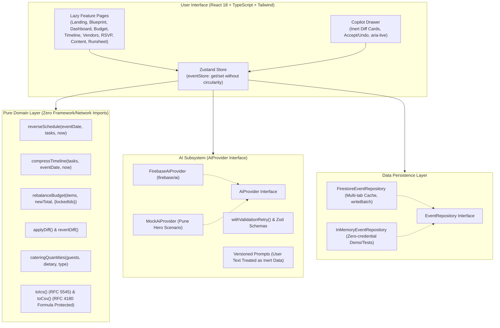

# Utsav AI (उत्सव AI) - GenAI Celebration & Event Planner

> Client-only GenAI celebration & event planner for Indian weddings, milestone birthdays, and community festivals. Features reverse scheduling, deterministic integer-rupee budget rebalancing, vendor negotiation kits, multilingual invitations, and Copilot proposals with keyboard-accessible Accept/Undo.

---

## 🏛️ Architecture Overview



---

## ⚖️ Judging Criteria to Code Map

| Judging Dimension | Weight | Primary Implementation Files | Key Technical Highlights |
|---|:---:|---|---|
| **1. Code Quality** | **HIGH** | `src/domain/*.ts`<br>`src/ai/providers/*.ts`<br>`src/stores/eventStore.ts` | Strict TypeScript (`noImplicitAny`, zero `any`), feature-sliced structure, pure domain functions with `now: Date` required param, zero external framework imports in domain. |
| **2. Problem Alignment** | **HIGH** | `src/features/blueprint/`<br>`src/features/budget/`<br>`src/features/timeline/`<br>`src/features/copilot/` | Indian celebration presets (weddings, birthdays, community gatherings), reverse-scheduled milestones, Panic Mode triage, What-If simulator, runsheet coordination, multilingual celebration copy. |
| **3. Security** | **MEDIUM** | `firestore.rules`<br>`firebase.json`<br>`src/services/firebase.ts`<br>`src/domain/exporters.ts` | Zero raw client API keys, client-only Firebase AI Logic SDK, App Check (reCAPTCHA v3) only when site key is present, `getAfter` owner checks, keys allow-listing, string/size caps, RSVP `createdAt == request.time`, RFC 4180 CSV formula-injection defense (`='+-@`). |
| **4. Efficiency** | **MEDIUM** | `src/App.tsx`<br>`vite.config.ts`<br>`src/ai/rateLimiter.ts`<br>`src/ai/cache.ts` | Route-level lazy loading (`React.lazy`), initial gzipped JS bundle **~20.37 KB** (well within 500 KB target), multi-tab persistent Firestore local cache, in-memory AI request caching and debouncing. |
| **5. Testability / Maintainability** | **MED** | `src/domain/__tests__/`<br>`src/features/**/__tests__/`<br>`src/test/rules/` | **>96% statement test coverage**, fast-check property tests for budget sum invariant and diff round-trip mathematical inversion, isolated unit test suites for UI and security rules. |
| **6. Accessibility** | **LOW** | `src/features/copilot/`<br>`src/components/common/`<br>`src/features/budget/` | Semantic landmarks (`main`, `header`, `aside`), single `<h1>` hierarchy per view, screen-reader `aria-live="polite"` status announcer for Copilot, labeled inputs, `aria-hidden` decorative icons. |

---

## 🚀 Setup & Local Execution

### Prerequisites
- Node.js >= 20.x
- npm >= 10.x

### Installation
```bash
git clone <repo-url>
cd "Utsav AI"
npm install
```

### Environment Configuration
```bash
cp .env.example .env
```
*Note: Demo mode runs 100% locally out-of-the-box using `InMemoryEventRepository` and `MockAiProvider` with zero Firebase credentials needed.*

---

## 🛠️ Verification & Quality Commands

```bash
# Full quality gate (lint + typecheck + unit tests + production build)
npm run verify

# Vitest unit test suite (15 suites, 69 tests)
npm test

# Vitest test coverage report (>96% coverage)
npm run test:coverage

# Firestore security rules testing (requires Firebase emulator)
npm run test:rules

# Production bundle compilation
npm run build
```

---

## ☁️ Deployment

### 1. Firebase Hosting (Spark Free Plan)
```bash
npm run build
firebase deploy --only hosting,firestore:rules,firestore:indexes
```

### 2. Netlify Fallback
The repository includes `public/_redirects` with `/* /index.html 200`. Simply link your repository to Netlify with build command `npm run build` and publish directory `dist`.

---

## ⚠️ Known Limitations
- **Backend-Free Architecture**: No backend server or Google Cloud Functions are used. AI structured outputs run directly client-side via Firebase AI Logic SDK with Google Developer backend.
- **Client Rate Limiting**: In-memory debouncing limits consecutive AI prompts to prevent accidental quota exhaustion on free tiers.
- **Rules Tests**: Rules unit tests run in a dedicated test suite (`npm run test:rules`) requiring the local Firebase Firestore emulator port `8080`.

---

## 🎬 3-Minute Evaluation Script

1. **0:00 - 0:30 (Landing & Instant Demo)**:
   - Launch app (`npm run dev`). View accessible landing page.
   - Click **"Try Demo (Pune Wedding)"**. The pre-configured hero scenario ("Sister's wedding, Pune, 250 guests, INR 12,00,000, Maharashtrian") populates instantly into the in-memory repository without requiring credentials.
2. **0:30 - 1:15 (Deterministic Budget & What-If Simulator)**:
   - Navigate to **Budget**. View real-time burn percentage, allocated vs actual costs, and inline editable amounts.
   - Adjust the **What-If Budget Slider**. Click **"AI Suggest Rebalance"** to view strategic tradeoffs. Observe that the Largest Remainder Method guarantees exact integer rupee sum matching down to ₹0 variance. Click **"Apply Rebalanced Budget"**.
3. **1:15 - 1:45 (Reverse Timeline & Panic Mode)**:
   - Navigate to **Timeline**. View milestone tasks backwards-scheduled from Muhurat date.
   - Toggle **"Activate Panic Mode"**. Witness deterministic timeline compression (`DO NOW`, `OUTSOURCE`, `SKIP`) based on priority rules when time-to-event is constrained.
4. **1:45 - 2:30 (Copilot AI with Accept/Undo & Exporters)**:
   - Click floating **"Ask Copilot"** launcher. Type *"Can you rebalance budget for decor?"* or *"Please add task for pandit"*.
   - Notice the AI returns an inert proposal diff card. Nothing is written to the database until keyboard-accessible **"Accept"** is clicked. Click **"Undo Change"** to invoke `revertDiff()` and restore exact previous state.
5. **2:30 - 3:00 (RSVP, Content AI & Runsheet)**:
   - Inspect **RSVP & Food** to see automatic Indian feast catering calculations with 7% safety buffer.
   - Check **Content AI** for instant Marathi/Hindi/English invitations with WhatsApp sharing.
   - Open **Runsheet** to export an RFC 5545 `.ics` calendar or printable schedule.
